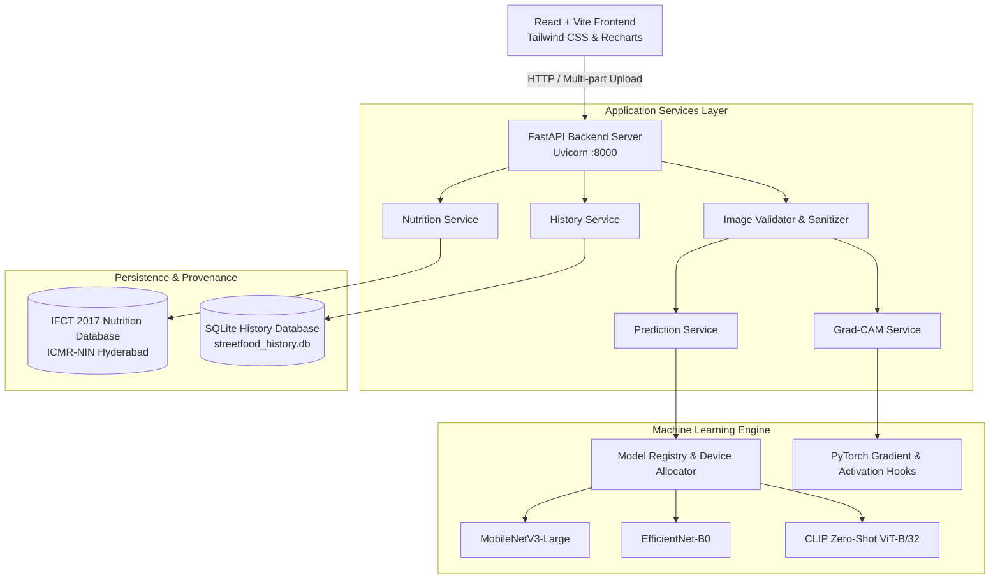

# StreetFoodAI: System Architecture

## 1. High-Level Architecture Overview

StreetFoodAI is designed with clean decoupling between the user interface, backend application programming interface, deep learning vision models, explainability engine, and nutritional composition database.

---

## 2. Component Breakdown

### 2.1. Presentation Layer (`frontend/`)
* **Framework:** React 19 bootstrapped with Vite.
* **Styling:** Tailwind CSS with custom Indian saffron palette (`#F97316`, `#D97706`) and warm neutral slate.
* **Component Hierarchy:**
  * `Navbar.jsx`: Global navigation and live backend connectivity status poll.
  * `ImageUploader.jsx`: Drag-and-drop zone with instant synthetic dish samples.
  * `ServingSelector.jsx`: Interactive portion adjustment (`Small`, `Regular`, `Large`).
  * `NutritionCard.jsx`: Macronutrient metric cards, distribution bar, and IFCT citations.
  * `UnknownFoodAlert.jsx`: Out-of-distribution detection notification with candidate options.
  * `GradCamModal.jsx`: Visual attention inspector comparing original image with activation overlay.

### 2.2. Application Server Layer (`backend/app/`)
* **Framework:** FastAPI with asynchronous lifespan management.
* **Validation:** Pydantic v2 schemas for all requests and responses.
* **Image Sanitization (`image_utils.py`):**
  * Verifies MIME headers (`image/jpeg`, `image/png`, `image/webp`).
  * Performs byte-level structural verification via PIL `verify()`.
  * Enforces minimum dimensions (50x50) and file size ceiling (10 MB).
* **Singleton Lifecycle:** Deep learning models and nutrition composition tables are loaded into memory once on application startup, avoiding latency overhead per request.

### 2.3. Machine Learning & Explainability Engine (`ml/`)
* **Backbones:**
  * **MobileNetV3-Large:** Lightweight inverted residual blocks with squeeze-and-excitation (4.23M params).
  * **EfficientNet-B0:** Compound scaled depth/width/resolution (4.03M params).
  * **CLIP (ViT-B/32):** Zero-shot contrastive language-image foundation baseline (151.3M params).
* **Grad-CAM Implementation (`ml/explainability/gradcam.py`):**
  * Registers PyTorch forward and backward hooks on the terminal convolutional block (`features[-1]`).
  * Computes global average pooled gradients:
    $$\alpha_k^c = \frac{1}{Z} \sum_i \sum_j \frac{\partial y^c}{\partial A_{ij}^k}$$
  * Applies ReLU rectification to capture positive feature attribution.
  * Resizes heatmap to 224x224 and overlays OpenCV JET colormap onto the input image.

### 2.4. Nutrition Estimation & Provenance (`backend/app/services/nutrition_service.py`)
* Sourced from the **Indian Food Composition Tables 2017 (IFCT 2017)** by the National Institute of Nutrition (ICMR-NIN), Hyderabad.
* Supports non-linear portion adjustments:
  * `Small`: Single piece / half portion (~60-220g)
  * `Regular`: Standard vendor serving (baseline 1.0x)
  * `Large`: Double piece / full meal (~140-600g)
* Mathematical proportional scaling verified via automated unit fixtures.
